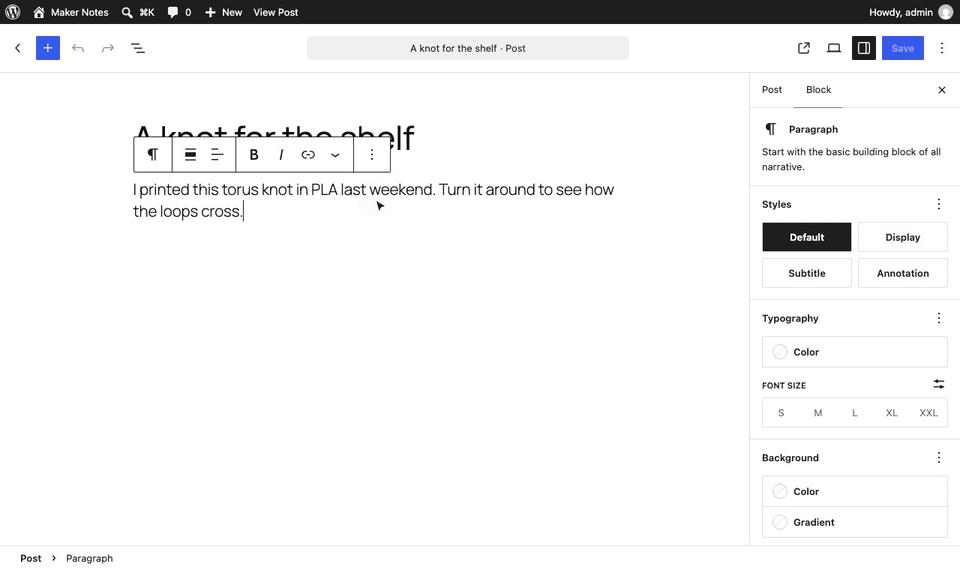
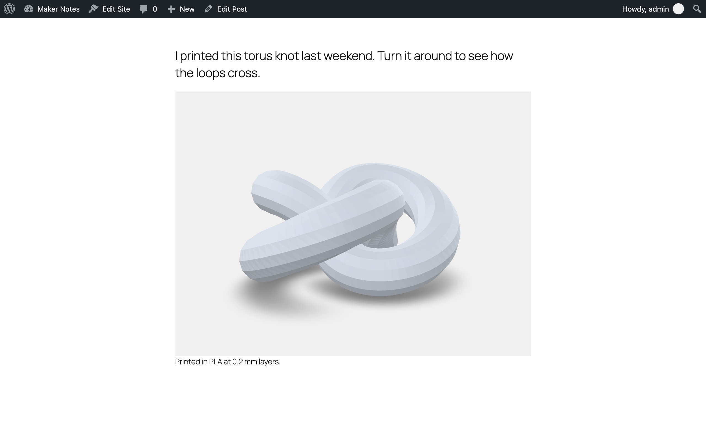
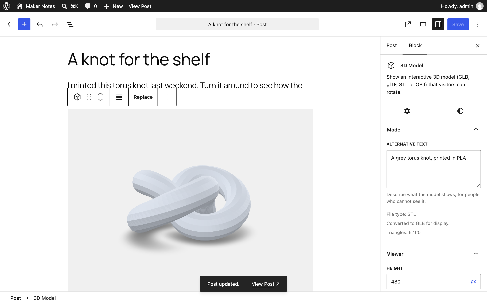
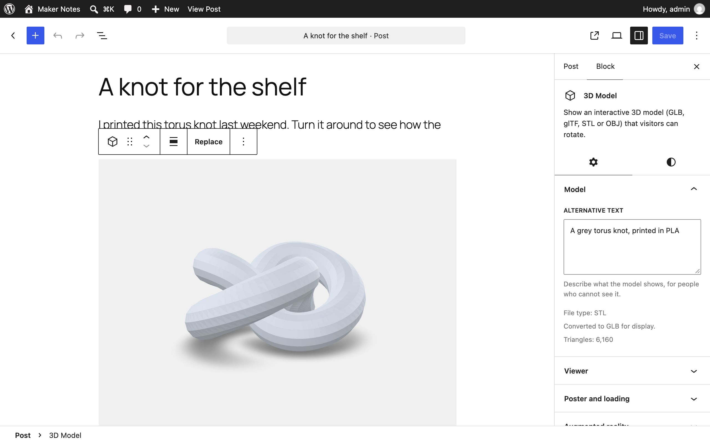
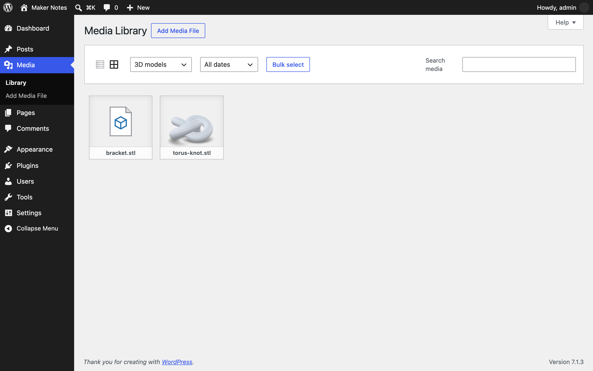

<p align="center"></p>

<h1 align="center">Embed 3D Models</h1>

<p align="center">
  <a href="https://playground.wordpress.net/?blueprint-url=https://raw.githubusercontent.com/pratik-londhe4/embed-3d-models/main/blueprint.json"></a>
  <a href="https://github.com/pratik-londhe4/embed-3d-models/releases/latest"></a>
  
  
  <a href="LICENSE.md"></a>
  <br>
  <a href="https://github.com/pratik-londhe4/embed-3d-models/actions/workflows/phpcs.yml"></a>
  <a href="https://github.com/pratik-londhe4/embed-3d-models/actions/workflows/phpstan.yml"></a>
  <a href="https://github.com/pratik-londhe4/embed-3d-models/actions/workflows/unit-tests.yml"></a>
  <a href="https://github.com/pratik-londhe4/embed-3d-models/actions/workflows/e2e-tests.yml"></a>
  <a href="https://github.com/pratik-londhe4/embed-3d-models/actions/workflows/plugin-check.yml"></a>
</p>

<p align="center">Upload GLB, glTF, STL and OBJ files and show them in posts as 3D models visitors can rotate.</p>

<p align="center">
  
</p>

---

WordPress refuses 3D files ("Sorry, you are not allowed to upload this file type") and has no way to show one. Embed 3D Models lets you upload them like images, checks each file by its content, converts STL and OBJ to GLB, and adds a **3D Model** block built on Google's open source [`<model-viewer>`](https://modelviewer.dev/).

> [!NOTE]
> Free and open source under the GPL. No pro version, no upsells, no ads in wp-admin, no tracking. Nothing loads from a CDN.

## Features

- **Uploads checked by content**: a `.glb` must really be binary glTF 2.0, an `.stl` must parse as STL, text files carrying `<?php` or `<script` are refused, and every refusal says why
- **STL and OBJ converted to GLB at upload**, streamed so large files do not exhaust memory; STL turned upright and scaled from millimetres
- **3D Model block** with the real viewer in the editor: alt text, caption, height, background, auto-rotate, controls, zoom (off by default so page scrolling never gets stuck), brightness, shadow, animation
- **Save current camera angle** and **Use current view as poster**; the poster also becomes the model's Media Library thumbnail
- **Lazy loading** by default, or **click to load** for heavy models
- **Augmented reality** on phones, with an optional USDZ file for iPhone and iPad
- Viewer and decoders bundled; loaded only on pages with a model
- "3D models" filter in the Media Library, Site Health check, WP-CLI, REST, Abilities API, PHP and JS hooks

## Install

1. Download `embed-3d-models.zip` from the [latest release](https://github.com/pratik-londhe4/embed-3d-models/releases/latest).
2. In WordPress, go to **Plugins > Add New Plugin > Upload Plugin**, choose the zip and activate it.

Or with WP-CLI:

```sh
wp plugin install https://github.com/pratik-londhe4/embed-3d-models/releases/latest/download/embed-3d-models.zip --activate
```

Needs WordPress 6.6+ and PHP 7.4+. The **Try in WordPress Playground** badge opens a throwaway WordPress in your browser with the plugin and a converted STL model.

## Quick look

Add the **3D Model** block, click **Upload** and pick a `.glb`, `.stl` or `.obj` file. STL and OBJ files are converted on the server and shown straight away. Give it alternative text, then **Use current view as poster** under *Poster and loading*.

| Format | Upload | Shown as |
| --- | --- | --- |
| GLB | checked | as uploaded (recommended: keeps colours, textures and animation) |
| glTF | checked, must be self-contained | as uploaded |
| STL | checked | converted GLB, grey |
| OBJ | checked | converted GLB, grey |
| USDZ | checked | iPhone and iPad AR file only |

```sh
wp embed-3d-models list
wp embed-3d-models convert 123 --ignore-limit   # an STL over the 64 MB upload limit
wp embed-3d-models check ~/Downloads/part.stl   # would it be accepted?
```

## Screenshots

<table>
  <tr>
    <td width="50%" valign="top"><br><sub>A 3D model in a post, with its caption</sub></td>
    <td width="50%" valign="top"><br><sub>The 3D Model block in the editor, with its settings</sub></td>
  </tr>
  <tr>
    <td width="50%" valign="top"><br><sub>An uploaded STL file, converted to GLB</sub></td>
    <td width="50%" valign="top"><br><sub>3D models in the Media Library, with posters as thumbnails</sub></td>
  </tr>
</table>

## Documentation

- [docs/REFERENCE.md](docs/REFERENCE.md): formats and checks, conversion, block attributes, hooks, REST, WP-CLI, abilities
- [docs/DEVELOPMENT.md](docs/DEVELOPMENT.md): local setup and tests
- [docs/CONTRIBUTING.md](docs/CONTRIBUTING.md), [docs/RELEASING.md](docs/RELEASING.md), [docs/SECURITY.md](docs/SECURITY.md)

## Files

```
embed-3d-models.php     plugin header, autoloader, boot
uninstall.php           removes converted GLBs and the plugin's metadata
block/block.json        the 3D Model block
src/Formats.php         accepted formats and messages
src/Media/              Validator, Converter, MeshWriter, Glb, Models, Uploads, Stream
src/Block/              Block (scripts, registration), Renderer (front end)
src/Rest/ src/Cli/ src/Health/ src/Abilities.php
assets/js/              block.js, attributes.js, view.js
assets/vendor/          model-viewer, Draco, KTX2 and meshopt decoders
tests/                  PHPUnit, Node and Playwright tests
```

## Credits

- [`<model-viewer>`](https://github.com/google/model-viewer) by Google, Apache-2.0
- Draco and KTX2 decoders from [three.js](https://github.com/mrdoob/three.js), MIT
- [meshoptimizer](https://github.com/zeux/meshoptimizer) decoder, MIT

## License

GPL-2.0-or-later. See [LICENSE.md](LICENSE.md).
